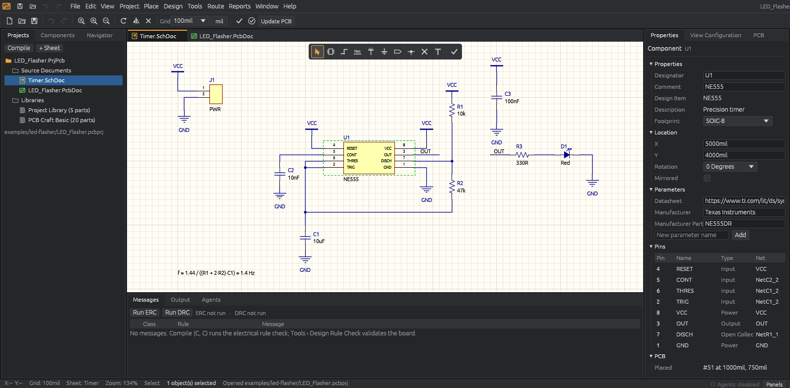

# Hephaestus

A Rust and egui desktop application for schematic capture and PCB design, modelled on Altium
Designer's workflow and built so that external engineering agents (Claude Code, Codex, any MCP
client, Python scripts) can inspect, edit and validate designs through the same validated core
as the user interface.



## What works today

- **Altium-style shell:** menus, quick access, toolbars and the floating Active Bar, document
  tabs, dockable/floating panels with persisted layout (Projects, Components, Navigator,
  Properties, View Configuration, PCB, Messages, Output, Agents), status bar, dark theme.
- **Schematic editor:** parts from the library with ghost placement, wires with hot-spot
  snapping, automatic junctions, net labels, power ports, ports, No-ERC, text; select, box
  select, drag/rotate/mirror with wires staying attached, unconnected pin and wire-end markers,
  page layouts (sheet size, orientation, title block), copy/paste, undo/redo, net
  highlighting, context menus, Properties editing.
- **PCB editor:** Update PCB from the schematic, footprint placement and movement, interactive
  routing (45°/90° modes, clearance halo, layer change inserts vias), vias, tracks, polygon pour
  and keep-out outlines, board shape, measurement, layer tabs and single-layer mode, ratsnest,
  cross-select with the schematic, align/distribute, locking.
- **Component library per project:** each project owns its components (one per value and
  footprint for passives) with symbol, footprint and 3D body, part numbers, approved alternates,
  origin and status badges; shared shapes stored once by content hash; component packs for
  moving parts between projects. See [docs/LIBRARY_FORMAT.md](docs/LIBRARY_FORMAT.md).
- **Engineering core:** integer-nanometre geometry, structured design database, netlist
  compiler, board connectivity, ERC and DRC with navigation, versioned multi-file JSON projects
  with incremental saves, autosave and recovery.
- **Manufacturing:** Gerber X2, Excellon drill, BOM, pick-and-place.
- **Agents:** 55 tools over MCP or a local JSON protocol; dry runs, transactions, approval of
  destructive changes, change history, structured errors. See [docs/AGENT_API.md](docs/AGENT_API.md).

See [docs/ROADMAP.md](docs/ROADMAP.md) for what is partial or planned (pour filling, KiCad
import, 3D, SPICE …).

## Quick start

```sh
cargo run --release -p hephaestus -- examples/led-flasher/LED_Flasher.pcbprj
```

Connect Claude Code while Hephaestus is running:

```sh
cargo build --release -p hephaestus-mcp
claude mcp add hephaestus -- "$PWD/target/release/hephaestus-mcp" --agent claude-code
```

Or script it:

```sh
PYTHONPATH=sdk/python python3 examples/agent_rc_filter.py
```

## Documentation

- [Architecture](docs/ARCHITECTURE.md)
- [UI design](docs/UI_DESIGN.md)
- [Agent API](docs/AGENT_API.md)
- [Component library format](docs/LIBRARY_FORMAT.md)
- [Development](docs/DEVELOPMENT.md)
- [Roadmap](docs/ROADMAP.md)

## License

Not chosen yet: the crate manifests currently declare `MIT OR Apache-2.0` to match the Craft
suite's `craft-ui` crate this project depends on, but no license files have been added. All icons
and library artwork are generated in code, so no third-party assets constrain the choice.
