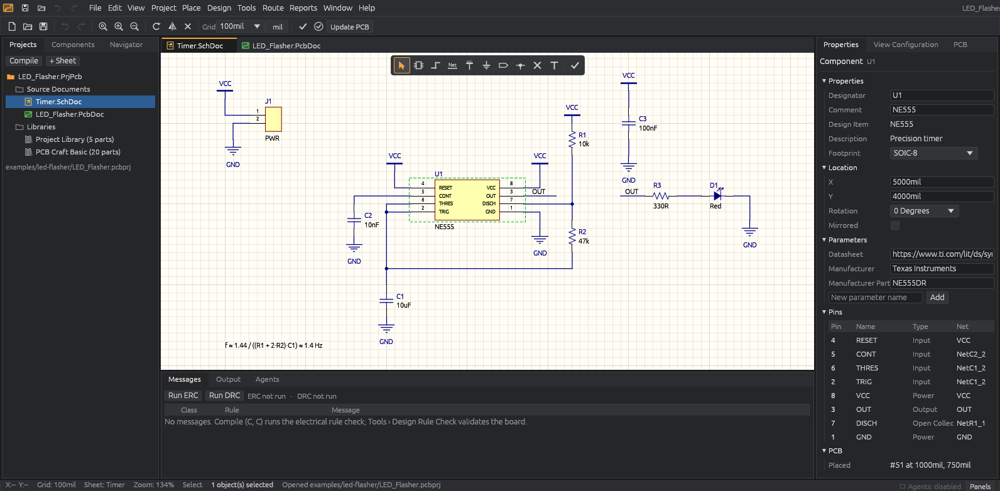
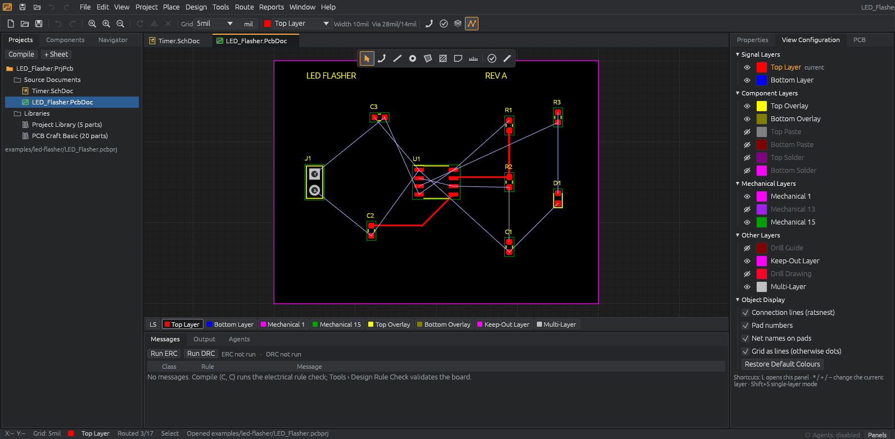

# Hephaestus — UI Design

Altium Designer is the reference for structure, density and interaction. Hephaestus recreates the
structure and workflows; it copies no Altium artwork (all icons are drawn in code,
`crates/ui/src/icons.rs`).




## Window structure

| Region | Contents |
|---|---|
| Menu row | Quick-access icons (save, open, undo, redo), menus **File Edit View Project Place Design Tools Route Reports Window Help**, project name, pending two-key shortcut. |
| Standard toolbar | New/Open/Save, Undo/Redo, zoom, rotate/mirror/delete, snap grid and units; schematic: Compile, ERC, Update PCB; PCB: current layer, preferred widths, routing, DRC, single-layer mode, connection lines; agent transaction/proposal indicator. |
| Document tabs | One per sheet (`*.SchDoc`) and the board (`*.PcbDoc`), fitted with craft-ui's tab fitting and an overflow menu; active tab marked with an amber top line. Each document keeps its own camera, selection, tool, active layer and highlighted net. |
| Active Bar | Altium's floating tool bar centred over the canvas, context-sensitive per editor. |
| Canvas | Schematic sheet on light paper with zone border and title block (Properties › Page Options: A0–A4, A–E, Letter, Legal, Tabloid; landscape or portrait; Standard, ANSI or no title block; zones on/off). PCB black board on a grey workspace with the grid drawn over the board. |
| PCB layer tabs | Colour-coded tabs along the bottom (`LS` single-layer toggle first); click to set the current layer. |
| Left dock | Projects, Components, Navigator. |
| Right dock | Properties, View Configuration, PCB (nets). |
| Bottom dock | Messages (ERC/DRC), Output (session log), Agents (history, proposals). |
| Status bar | Cursor X/Y in display units, snap grid, sheet and zoom (schematic) or current layer, routing mode and completion (PCB), current tool, selection count, status message, agent port indicator, **Panels** menu. |

Panels are movable, tabbable, floatable, resizable and closable (craft-ui docking). The layout,
units, grids, layer colours/visibility and navigation preferences persist between sessions
(eframe storage). View › Reset Workspace Layout restores the default.

## Theme

Dark engineering theme (`crates/ui/src/theme.rs`): `#1b1c1e` document area, `#252628` panels,
1 px `#3c3e43` borders, 12.5 px UI text, 20 px rows, 2 px corner radius, blue selection rows,
amber for the active tool and document. Schematic colours follow Altium's defaults (navy wires
and junctions, dark-red component outlines over light-yellow fill, black pin text). PCB layer
colours follow Altium's defaults (Top red, Bottom blue, Top Overlay yellow, Multi-Layer silver,
Keep-Out magenta …) and are editable in View Configuration.

## Navigation (both editors)

| Action | Input |
|---|---|
| Pan | Right-drag, middle-drag, mouse wheel (Shift+wheel horizontal) |
| Zoom at cursor | Ctrl+wheel, PgUp/PgDn, pinch |
| Fit all objects / fit document | Ctrl+PgDn, `V F` / `V D` |
| Fit selection | `Z S` |
| Units | `Q` |
| Snap grid | `G` cycles, toolbar combo |

Preferences can make the plain wheel zoom.

## Selection and editing

- Click selects the top-most object (small objects win over large); Shift+click toggles.
- Drag on empty space draws a selection box: left→right selects objects fully inside (solid
  box), right→left selects objects it touches (dashed box), as in Altium.
- Drag a selected object to move it with live preview, snapped to the grid. Attached wiring
  follows in the preview and on release: schematic wires bend to stay orthogonal and stay on
  moved pins, labels and ports; PCB tracks stay on moved pads. Rotate and mirror keep wires
  attached too. Hold Ctrl to move without dragging wires. A red cross marks where a moving pin
  lands on something it will connect to.
- Connection feedback on the schematic: red open circles on pins that touch nothing, red squares
  on wire ends that touch nothing, red dots on labels and ports that are not attached. Hovering a
  wire, label or pin shows its net and pin count next to the pointer.
- Double-click opens the object in Properties. Right-click opens a context menu (cut/copy/paste,
  rotate, mirror/flip, align, cross-probe, place, compile/DRC, fit).
- Alt+click (schematic) or Ctrl/Alt+click (PCB) highlights a net and dims everything else;
  Shift+C or Esc clears it.
- Cross-select: selecting a component in one editor selects it in the other; Tools › Cross Probe
  jumps there.
- Ctrl+C / Ctrl+X / Ctrl+V copy and paste at the cursor (new designators are assigned).

## Schematic tools

Part (Components panel or `P P`), Wire (`P W`), Net Label (`P N`), VCC (`P O`), GND (`P G`),
Port (`P R`), Junction (`P J`), No ERC (`P V`), Text (`P T`).

- Placement tools show a ghost; Space rotates, X mirrors (parts), click places and the tool stays
  active; Esc or right-click exits.
- Net labels and ports auto-increment trailing numbers (`D0` → `D1`).
- Wires snap to electrical hot spots (pin ends, wire vertices, labels) within 8 px, shown with a
  red cross; corner modes cycle with Space; a wire ends automatically on a hot spot or wire;
  Backspace removes the last vertex; double-click/Enter/Esc/right-click finishes.
- Automatic junction dots appear where three or more connections meet or a wire tees into
  another.

## PCB tools

Interactive Routing (Ctrl+W, `P T`), Line (`P L`), Via (`P V`), Polygon Pour (`P G`), Keepout
(`P K`), Redefine Board Shape, Measure (Ctrl+M).

- **Interactive routing** is not freehand drawing. Click a pad/track/via to pick up its net
  (track width from the net class or the preferred width). The preview shows the 45° (or 90°,
  any-angle) path with a translucent clearance halo; copper of other nets that would be violated
  is outlined. Click commits vertices; changing the layer (`*`, `+`, `-`, layer tabs) inserts a
  via and continues on the new layer; clicking copper of the same net finishes; Backspace
  removes a vertex; Esc/right-click/Enter finishes and keeps what was placed. The net's ratsnest
  stays highlighted while routing.
- Footprints: drag to move, Space rotates, Alt+L or Edit › Flip moves to the other side, Lock in
  the context menu or Properties.
- Single-layer mode (Shift+S, `LS`) greys out other layers.

## Properties

Context-sensitive: document options (sheet name/title/size/revision, grid; board size, layer
count, routing rules, origin) with nothing selected; tool options while a tool is active (net
label text, power net and style, port name and I/O type, routing net/width/vias); per-object
editors for components (designator, comment, footprint choice, location, rotation, mirror,
parameters, pins with nets), wires, labels, power ports, ports, text, footprints (side, lock,
pads with nets), tracks (net, layer, width, endpoints), vias, pours and keep-outs; and a
multi-selection summary with common edits. Text and length fields commit on Enter or focus loss,
accept unit suffixes (`10mil`, `0.25mm`) and every edit is undoable.

## Visual validation procedure

Screenshots are produced by the application itself, so they work on Wayland and X11 without
external tools:

```sh
cargo run -p hephaestus -- examples/led-flasher/LED_Flasher.pcbprj --port 0 \
  --document sch --select U1 --screenshot docs/screenshots/schematic.png --exit
cargo run -p hephaestus -- examples/led-flasher/LED_Flasher.pcbprj --port 0 \
  --document pcb --panel Layers --screenshot docs/screenshots/pcb.png --exit
```

Agents can also call `ui.screenshot` on a running instance. Each UI change is checked against
both workspaces for panel alignment, toolbar and tab dimensions, canvas fit, Properties content,
selection feedback and status bar information. Interaction behaviour (clicks, drags, keys) is
covered by headless egui_kittest tests in `crates/ui/src/tests.rs`.
